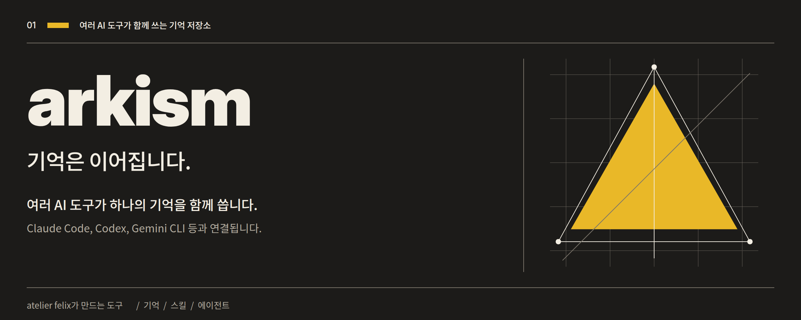
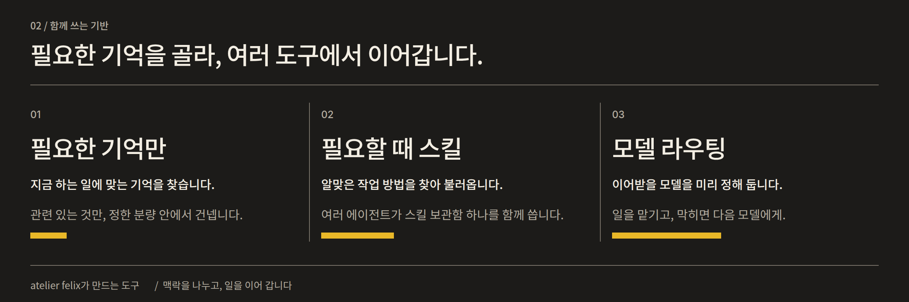
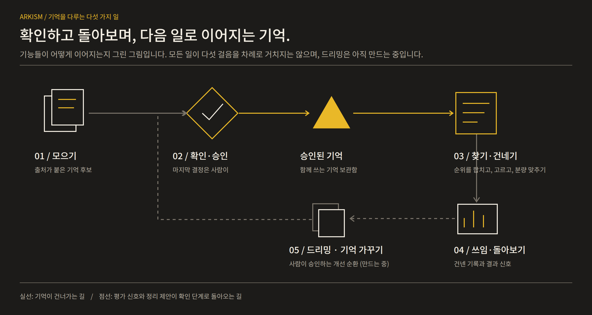
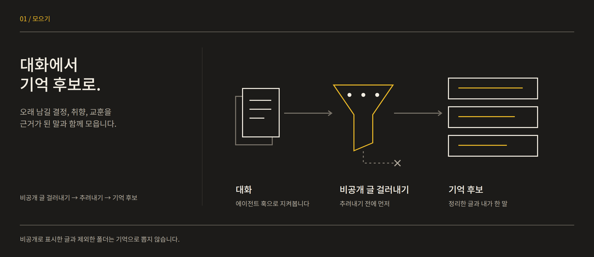
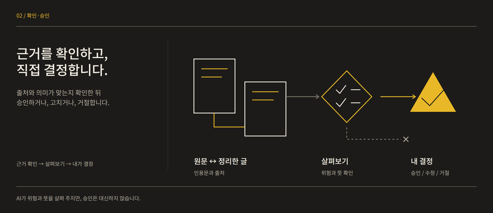
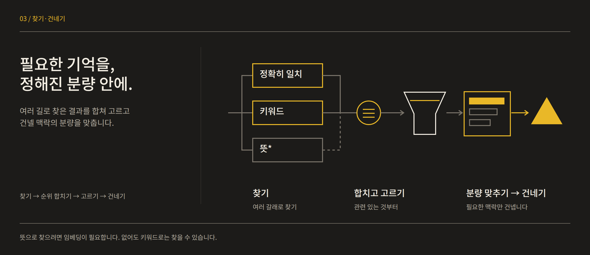
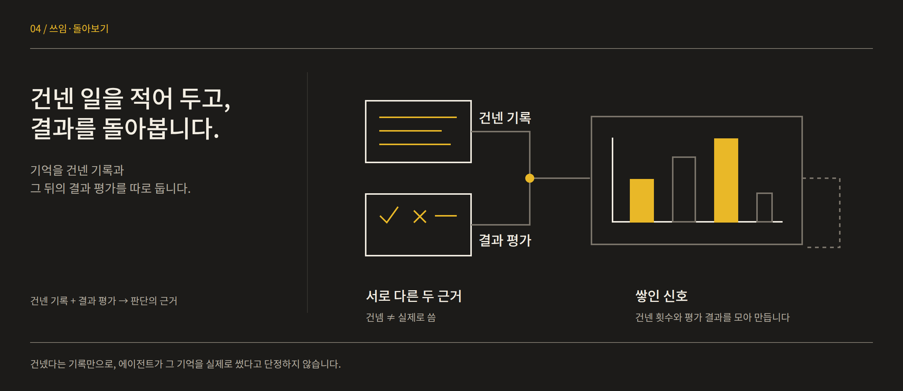
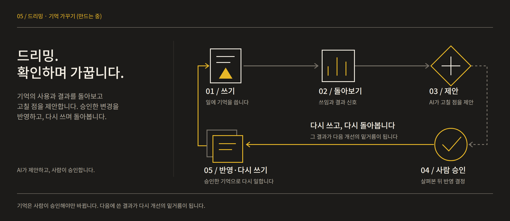
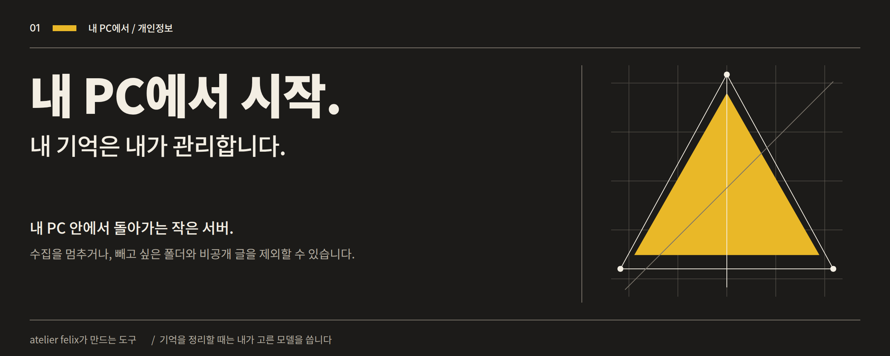
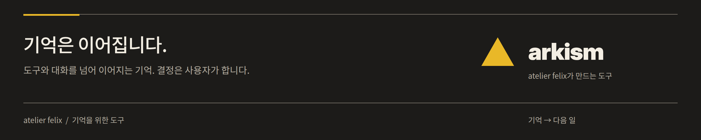

# Arkism

 

**기억은 이어집니다.** Arkism은 여러 AI 코딩 에이전트가 기억과 스킬을 함께 쓰게 해 주는 오픈 소스 앱입니다.

Claude Code, Codex, Gemini CLI를 오갈 때 쓸 맥락을 잇기 위해, 대화에서 남길 내용을 모으고 지금 하는 일에 맞는 승인된 기억을 건넵니다. 실제 에이전트 시험에서 기억은 작업에 전달됐지만, 정적 지침 문서보다 낫다는 증거는 아직 없습니다([보고서](evaluation/reuse-20261015/REPORT.ko.md)). 기억과 도구, 모델 선택, 팀 워크플로를 한곳에서 관리합니다.

> 현재 테스트·개발 중입니다. 아래의 제품 소개와 [앞으로의 로드맵](ROADMAP.ko.md)을 구분해 읽어 주세요.

---

## 1. 내 작업은 바뀌어도, 맥락은 이어지도록

- **함께 쓰는 기억.** 결정, 선호, 해결 방법을 출처와 함께 보관합니다.
- **내가 결정하는 기억.** AI가 정리한 내용은 후보입니다. 사람이 승인한 뒤 에이전트가 사용합니다.
- **함께 쓰는 스킬.** 작업 방법을 한곳에서 버전과 이력으로 관리합니다. MCP로 연결된 에이전트는 이를 불러올 수 있고, 스킬 폴더 설치는 Claude Code·Codex·ZCode만 지원합니다.
- **연결된 작업.** 모델 라우팅과 자체 워크플로 엔진으로 작업과 팀을 구성합니다.

기본은 내 PC에서 시작합니다. Arkism 계정이나 Docker 없이 사용할 수 있으며, 기억 추출에는 내가 선택한 모델과 에이전트 로그인을 사용합니다. 모델 공급자에 따른 이용 조건과 비용은 따로 적용됩니다.

---

## 2. 기억이 이어지는 방식

### 2.1 모으기

연결된 에이전트의 대화에서 결정, 선호, 해결 방법을 후보로 정리합니다. 근거가 된 원문을 연결하고, 지원되는 수집 경로에서 비공개 표시와 제외 폴더를 먼저 걸러냅니다.

### 2.2 확인하고 승인하기

내 발언을 인용한 후보도 검토를 기다립니다. 출처와 뜻을 확인한 뒤 사람이 승인하거나 고치거나 거절합니다. AI의 분석이 사용자의 승인을 대신하지 않습니다.

### 2.3 찾아 건네기

현재 작업과 관련된 승인된 기억을 찾고, 순위를 합쳐 정해진 분량 안에서 전달합니다. 뜻으로 찾으려면 임베딩 설정이 필요하며, 설정하지 않은 경우 키워드 검색을 사용할 수 있습니다.

### 2.4 쓰임 돌아보기

기억을 건넨 기록과 작업 결과 신호를 구분합니다. 건넸다는 사실만으로 모델이 실제로 사용했거나 좋은 결과의 원인이 됐다고 단정하지 않습니다.

### 2.5 가꾸기 — 드리밍

**전체 개선 순환은 개발 중입니다.** 중복·충돌 정리 제안과 결과 신호를 바탕으로, 변경 이유와 범위를 검토하고 사람이 승인한 내용을 적용한 뒤 다음 작업에서 다시 확인하는 방향입니다. 제안·승인·적용·효과 확인을 각각 구분합니다.

구체적인 보강 순서와 완료 기준은 [로드맵](ROADMAP.ko.md)에 담았습니다.

---

## 3. 기억에서 작업까지

| 영역 | 할 수 있는 일 |
|---|---|
| **MEMORY** | 기억 후보 검토, 검색·수정·병합·삭제, 세션 조회와 내보내기, 사용량 확인. |
| **FLOW** | 단독 작업·협업·회의·자동화를 한 목록에서 관리. 기존 역할/페르소나와 팀 설정, 그래프, 실행 기록을 유지합니다. |
| **ROUTER** | 모델 공급자와 계정 등록, 라우팅 규칙과 대체 모델 순서 설정, 호출 기록 확인. |
| **TOOLS** | 스킬의 버전과 검사 기록, 스킬을 쓴 에이전트가 보고한 성공·실패 결과(자기 보고이며 따로 검증하지 않음), 에이전트별 MCP·플러그인 연결, 지식 자료 관리. |

워크플로는 Go로 만든 Arkism 자체 엔진에서 실행됩니다. 팀 회의와 실제 작업 실행은 서로 다른 흐름으로 관리합니다.

---

## 4. 시작하기

1. [Releases](https://github.com/FelixBaek/arkism/releases/latest)에서 공개된 설치 파일을 받습니다. 현재 공개 저장소 안내 기준으로 Windows 설치 파일을 배포합니다.
2. 앱을 열고 **내장 모드**로 시작합니다. 서버와 데이터베이스가 내 PC에서 실행됩니다.
3. 사용할 에이전트를 연결하고 평소처럼 작업합니다. 연결 과정에서 변경하는 에이전트 설정은 먼저 백업합니다.
4. **MEMORY**에서 기억 후보를 검토하고, 이후에도 사용할 내용만 승인합니다.

현재 공개 Windows 설치 파일에는 Authenticode 게시자 서명이 없어 SmartScreen 경고가 표시될 수 있습니다. 앱 업데이트 검증 서명은 별개입니다. 설치·업데이트 확인 방법은 [보안 안내](https://github.com/FelixBaek/arkism/blob/main/guide/security-operations.md)를 참고하세요.

여러 PC에서 하나의 Arkism을 쓰려면 [서버 모드](https://github.com/FelixBaek/arkism/blob/main/guide/server.md)를 사용할 수 있습니다. 서버의 데이터베이스와 SSH 연결을 별도로 설정합니다.

---

## 5. 내 데이터의 위치와 사용

**내장 모드의 데이터는 내 PC에 저장됩니다.** 기억, 스킬, 세션 기록과 사용량을 보관하며, 보관되는 세션 원문은 암호화합니다. 서버 모드에서는 설정한 서버의 데이터베이스를 사용합니다.

기억 후보를 만들 때는 관련 대화 일부가 내가 선택한 모델 공급자로 전송됩니다. 모델 라우팅과 연결한 외부 도구의 실행도 해당 공급자와 통신할 수 있습니다.

- 수집을 멈추거나 제외할 폴더를 설정할 수 있습니다. `.arkism-ignore`로 폴더를 제외할 수도 있습니다.
- `<private>…</private>` 표시가 있는 내용은 지원되는 수집 경로에서 추출·모델 전달 전에 제외합니다. 해당 표시가 포함된 세션은 원문 보관 대상에서도 제외합니다.
- 기억과 세션을 삭제하고, 세션을 내보내고, 데이터를 백업·복원할 수 있습니다. 수집 제외 설정은 이미 저장된 데이터를 지우는 기능과 구분됩니다.

적용 범위와 제한은 [수집·개인정보 안내](https://github.com/FelixBaek/arkism/blob/main/guide/capture-privacy.md), 복구 방법은 [백업 안내](https://github.com/FelixBaek/arkism/blob/main/guide/backup-restore.md)에 있습니다.

---

## 6. 개발과 검증

| 자동으로 확인하는 범위 | 검사 내용 |
|---|---|
| **서버와 데이터** | Go 테스트·동시성 검사, PostgreSQL 통합 테스트, OpenAPI 구조와 실제 응답 검증, 오프라인 평가 코드 회귀 검사. |
| **Windows와 데스크톱** | Windows 경로·설치 복구·제거 경계, Rust/Tauri 테스트, Windows Chromium에서 UI와 키보드 조작 회귀 검사. |
| **보안과 코드 품질** | CodeQL, gitleaks, govulncheck, SonarCloud 분석. |
| **테스트 범위** | Codecov로 Go·UI·Windows 설치 관련 코드의 커버리지를 추적하고 변경 코드 기준을 확인. |

일반 CI의 브라우저 회귀 검사와 제품 빌드·화면 비교는 구분됩니다. 제품 빌드·화면 비교는 수동 옵션으로 실행하며, 설치파일 생성과 릴리스 게시도 별도 조건을 따릅니다. 최근 실행 상태는 [GitHub Actions](https://github.com/FelixBaek/arkism/actions)에서 볼 수 있습니다.

제품 개선은 재현 가능한 비교에서 시작합니다. 새로운 방법은 기존 방식과 같은 조건에서 비교하고, 성공뿐 아니라 실패·재시도·확인하지 못한 결과와 전체 비용을 함께 기록합니다. 자동 검사의 통과와 실제 작업에서의 효과는 따로 확인합니다.

개발 환경과 실행 명령은 [개발 안내](https://github.com/FelixBaek/arkism/blob/main/guide/development.md), 기여 방법은 [CONTRIBUTING](https://github.com/FelixBaek/arkism/blob/main/CONTRIBUTING.md), 취약점 신고는 [SECURITY](https://github.com/FelixBaek/arkism/blob/main/SECURITY.md)에 있습니다.

---

## 7. 앞으로의 방향

**먼저 비교할 바탕을 만들고, 기억과 복구를 다듬은 뒤, 근거가 있는 확장을 진행합니다.** 기억 품질, 사람이 이해할 수 있는 정정 상태, 팀 실행, 모델 선택, 도구 호환성을 함께 살핍니다.

[이미지와 설명으로 보는 로드맵 →](ROADMAP.ko.md)

---

## 라이선스

[MIT](https://github.com/FelixBaek/arkism/blob/main/LICENSE)

### FLOW 호출과 리서치

`@리서치`는 기본 조사를, 같은 정의의 `@딥리서치` 별칭은 깊은 조사 진입을 선택합니다. 기존 리서치의 **개선안 검토 → 저장**으로 근거 부족 판정과 깊은 별칭을 추가하며 모델·검색 경로·승인·예산을 보존합니다. 소요 시간만으로 깊은 조사로 전환하지 않습니다. 기존 `$이름` 호출도 유지합니다.

연결된 에이전트는 `run_workflow` 뒤 `wait_workflow`로 같은 실행의 최종 결과를 받습니다. 닫힌 대화 자동 깨움은 지원하지 않으며 재연결 시 같은 ID로 조회합니다. Discord는 원래 대화에 최종 결과를 분할 전달하고 재시작 시 저장된 영수증부터 이어갑니다. 실제 전송 여부가 불명확하면 자동 재발송하지 않습니다. [호출·지원 범위](guide/flow.md)
