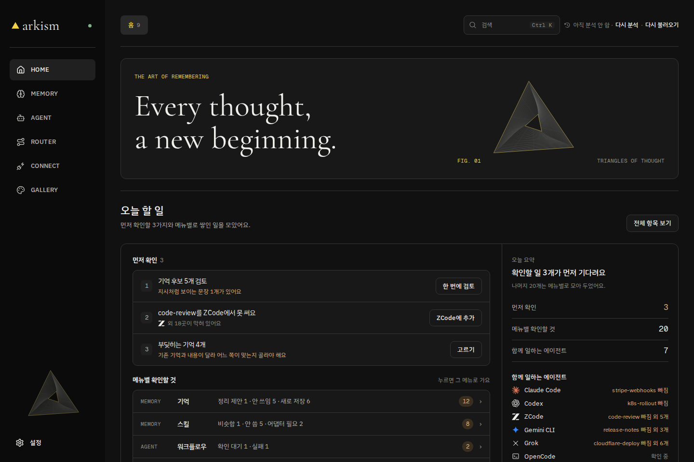
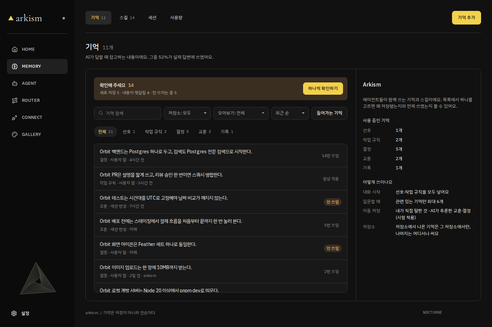
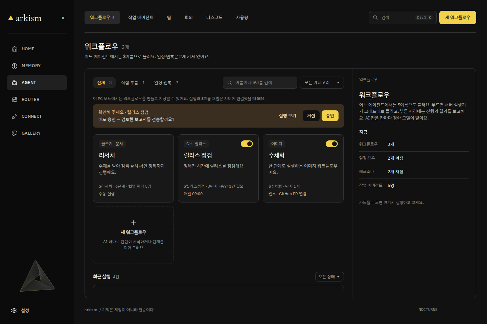
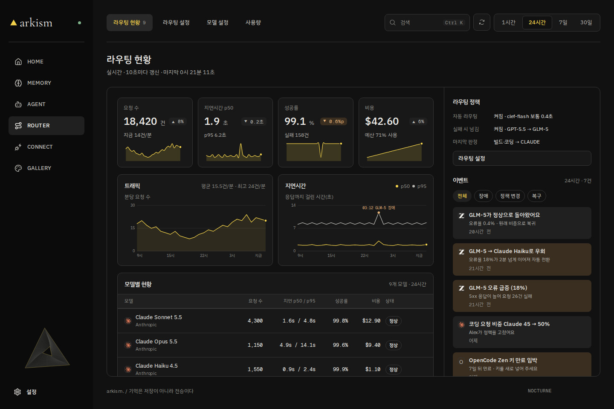

# Arkism

[](https://github.com/FelixBaek/arkism/actions/workflows/checks.yml)
[](https://github.com/FelixBaek/arkism/security/code-scanning)
[](https://sonarcloud.io/summary/new_code?id=FelixBaek_arkism)
[](https://sonarcloud.io/summary/new_code?id=FelixBaek_arkism)
[](https://sonarcloud.io/summary/new_code?id=FelixBaek_arkism)
[](https://app.codecov.io/gh/FelixBaek/arkism)
[](https://sonarcloud.io/summary/new_code?id=FelixBaek_arkism)
[](https://github.com/FelixBaek/arkism/actions/workflows/checks.yml)
[](https://github.com/FelixBaek/arkism/security/dependabot)
[](https://github.com/FelixBaek/arkism/security)

[한국어](README.ko.md)

Arkism gives your AI coding agents one shared memory.

Claude Code, Codex, Gemini CLI and other agents each forget what you told them yesterday, and each keeps its own skills. Arkism sits next to them. It collects what is worth remembering from your sessions, lets you review it, and hands the right memories and skills back to every agent. A desktop app shows all of it in one place, together with usage, model routing and multi-agent workflows.

**Who it is for:** people who use more than one AI coding agent every day and want them to share context, skills and limits, without sending their data to another cloud service.

- Runs on your PC by default. No account, no Docker, no API key.
- A memory extracted by an AI is not used until a person approves it. Even a quoted user statement waits for review.
- Open source (MIT). Go server, Tauri desktop app.

## Screenshots

| HOME | MEMORY |
|---|---|
|  |  |
| **AGENT** | **ROUTER** |
|  |  |

The screenshots use made-up sample data and show the Korean interface. Switch to English in **Settings › 모양 (Appearance)**.

## Install

Download the file for your system from [Releases](../../releases/latest).

| System | File |
|---|---|
| Windows 10/11 | `Arkism-X.Y.Z-setup.exe` |
| macOS (Apple silicon) | `.dmg` |
| Linux | `.AppImage` or `.deb` |

The builds are not signed yet. The first time you open the app, Windows SmartScreen asks you to confirm ("More info" → "Run anyway"). On macOS, right-click the app and choose "Open".

## Quick start

1. Install and open Arkism. It starts in **built-in mode**: the app runs its own small database and Arkism server on this PC, listening on `127.0.0.1` only.
2. The app finds the agents on this PC (Claude Code, Codex, ZCode, Gemini CLI, Grok, Claude desktop) and connects them through hooks and MCP. Before it changes an agent's settings, it saves a copy in `~/.config/arkism/backups`.
3. Use your agents as usual. Memories, skills, sessions and usage show up in the app.
4. Review new memories in **MEMORY › 기억 (Memories)**. Approve the ones you want your agents to use.

Want several PCs to share one Arkism? See [Server mode](#server-mode-optional).

## Features

| Menu | What you can do |
|---|---|
| **HOME** | Search memories, skills, workflows and prompts at once, and see what needs your attention in each menu. |
| **MEMORY** | Memories, skills, sessions and usage. Search, review, edit, merge and delete memories. Browse skills with their versions and test results. Read and export past agent sessions. |
| **AGENT** | Build workflows on a canvas, set up work agents and teams, run team meetings, connect Discord, and track the cost of runs. |
| **ROUTER** | See which model handled which task, set routing rules and fallbacks, and add model providers and accounts. |
| **CONNECT** | Turn agents, MCP servers and plugins on or off per agent, and browse Git repositories and pull requests. |
| **GALLERY** | Design systems, generated images and slides. |
| **Settings** | Connection (built-in or server), models per role, appearance (Korean or English, light or dark), capture, backups and data deletion. |

## How it works

**Memory.** While you work, Arkism watches the conversation through the agent's hooks. When something looks worth keeping (a decision, a preference, a fix that worked), it asks a small model to write it down as a *memory candidate*. The model runs through your own agent login (Claude by default). Candidates wait for a person to approve or reject them. An extraction label such as `explicit_user` describes the source; it is not approval. Owner credentials and legacy service review policies do not authorize capture to approve candidates. A direct, authenticated human review remains available through the app or review API. A reviewed memory keeps a link to the session it came from. When you start a new session, Arkism adds the few memories that fit the current task to the agent's context, within a fixed size budget.

**Skills.** Skills are `SKILL.md` folders, the format Claude Code and other agents already use. Arkism keeps one shared copy of each skill, with versions and history, and installs it for every connected agent. Agents can also look up skills on demand through the Arkism MCP server. Arkism records which skills were used and how they did, and can suggest new skills from repeated work.

**Routing.** You list the models you can use (subscriptions or API keys) in **ROUTER › 모델 설정 (Model settings)**. For each task, the router picks a model from your rules. If a model fails or hits its limit, the call moves to the next one in your fallback order. Routing records only which model ran, how long it took and whether it worked; it does not store prompts or answers.

**Search.** Built-in mode searches by keywords. If [Ollama](https://ollama.com) runs on the same PC with an embedding model (`ollama pull qwen3-embedding:0.6b`), Arkism also searches by meaning. You can change this in **Settings › 역할별 모델 (Models per role)**.

## Privacy

**What is stored**

- Memories and memory candidates, with a pointer to the session they came from.
- Skills and their versions.
- Session records: agent, model, token counts, tools and skills used.
- Archived session transcripts, encrypted with a key that is created on your PC. They are used to show where a memory came from.
- Routing and usage counts. No prompts or answers.

**Where it is stored**

In built-in mode everything stays on your PC, in the app's data folder:

| System | Folder |
|---|---|
| Windows | `%LOCALAPPDATA%\dev.arkism.desktop\runtime` |
| macOS | `~/Library/Application Support/dev.arkism.desktop/runtime` |
| Linux | `~/.local/share/dev.arkism.desktop/runtime` |

Capture settings and agent setting backups are in `~/.config/arkism`. In server mode the data is in the server's Postgres database.

**What leaves your PC.** To write a memory candidate, Arkism sends the relevant part of a conversation to the model you chose for extraction, using your own agent login. That is the same provider your agent already talks to. Nothing is sent to the Arkism authors.

**Keeping things out**

- Wrap words in `<private>…</private>` in a prompt. They are never captured, searched or sent to a model.
- **Settings › 고급 (Advanced) › 수집 (Capture)**: pause capture, or list folders Arkism must ignore.
- Put an empty `.arkism-ignore` file in a folder to keep Arkism out of it and everything below it.

**Delete, export, back up**

- Delete a memory or a session in the app. Deleting a source also removes every memory made from it.
- Export sessions as Markdown or JSON from **MEMORY › 세션 (Sessions)**.
- **Settings › 고급 › 데이터 (Data) › 지금 백업 (Back up now)** saves a full backup to `Documents/Arkism Backups`. The app also makes one backup a day and keeps the last seven. The same screen restores a backup or erases all data.
- Uninstalling disconnects the agents (the Windows uninstaller, or `arkism uninstall-arkism` elsewhere). Your data folder stays until you erase it.

## Server mode (optional)

Run Arkism on one machine and connect every PC to it. Good for a home server or a small team.

1. On the server, install Postgres 17 with pgvector and start the API and the worker: [guide/server.md](guide/server.md#install-by-hand).
2. Install the `arkism` tool on the server and save the owner token where it can read it. Details: [guide/server.md](guide/server.md#connect-the-desktop-app-over-ssh).
3. In the app, open **Settings › 연결 (Connection)** and type the server's SSH address, for example `me@my-server`. Nothing else is needed. The app logs in with your normal SSH keys, reads the connection details from the server, and forwards the API over that SSH connection.

Configuration, systemd and backups: [guide/server.md](guide/server.md) and [guide/backup-restore.md](guide/backup-restore.md).
- Use Supabase Cloud instead of running Postgres yourself: [guide/server.md](guide/server.md#use-supabase-cloud-as-the-database).

## Discord bot

`arkism discord` connects Discord bots you add in **AGENT › 디스코드 (Discord)**. A post in a connected channel can start a team meeting, a workflow or one agent answer.

Short version:

1. Create an application at <https://discord.com/developers/applications>, open **Bot**, press **Reset Token** and paste the token into Arkism.
2. On the **Bot** page, turn on **Message Content Intent**.
3. Invite the bot with `arkism discord invite APPLICATION_ID`. The link asks only for the permissions the bot needs. Do not give it Administrator.

Full setup: [guide/discord.md](guide/discord.md).

## Development

You need Go (version in `go.mod`) with a C compiler, Node.js 22 and Python 3. Rust (stable) is needed only for the desktop app.

```bash
go vet ./...
go test -race ./...
node --test desktop/ui/*.test.js
cd desktop/src-tauri && cargo test  # desktop app
```

Repository layout, Postgres integration tests and desktop builds: [guide/development.md](guide/development.md).

## License

[MIT](LICENSE)
