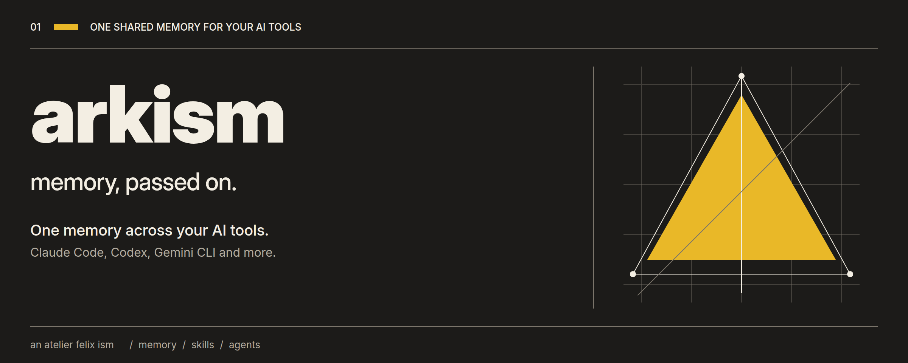
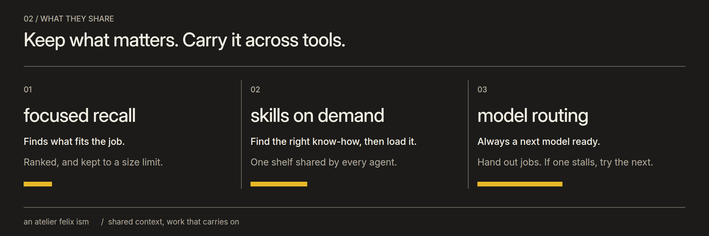
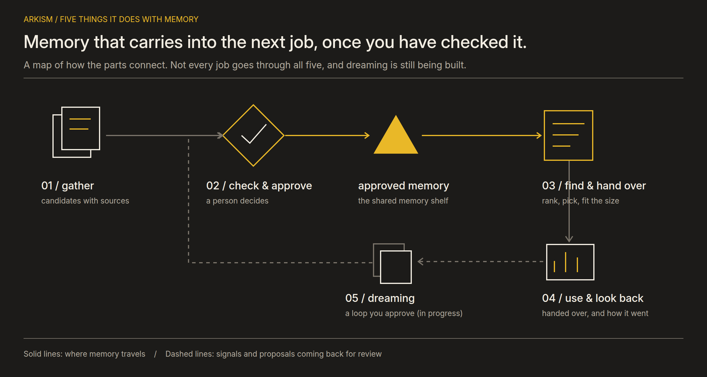
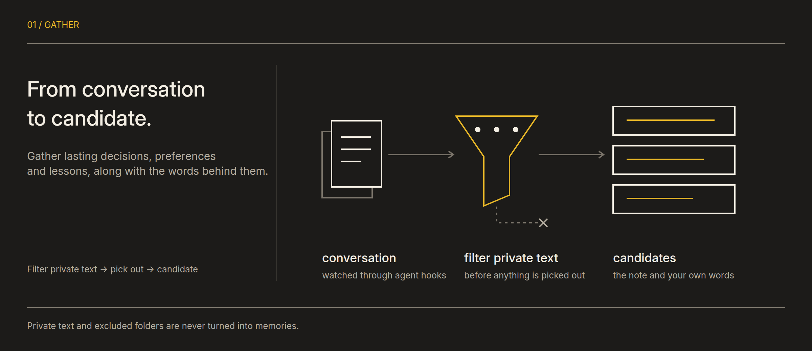
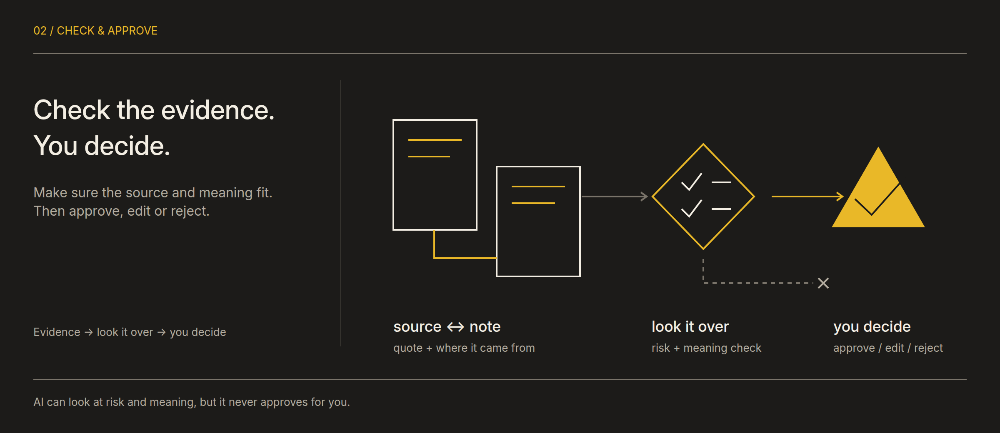
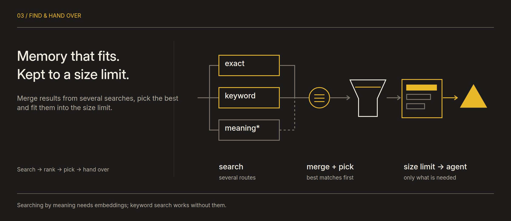
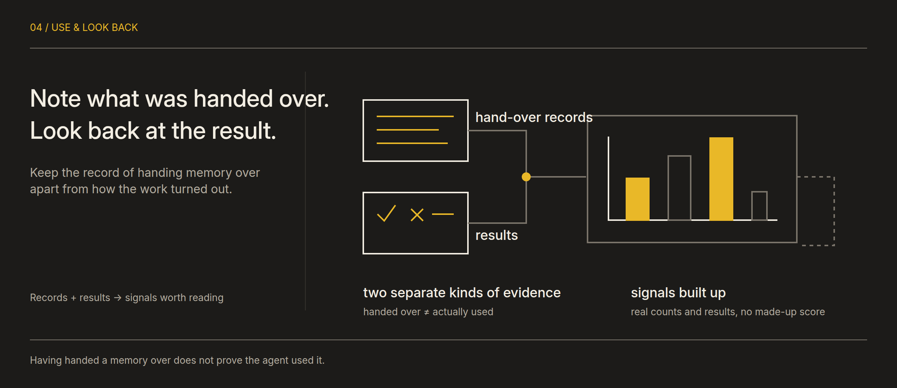
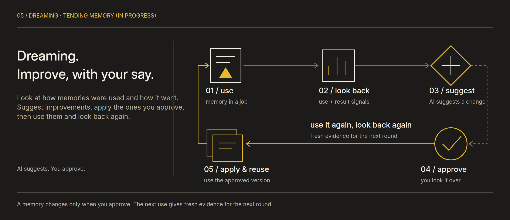
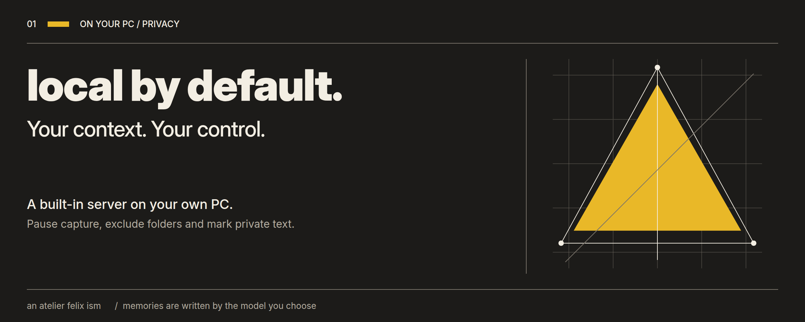
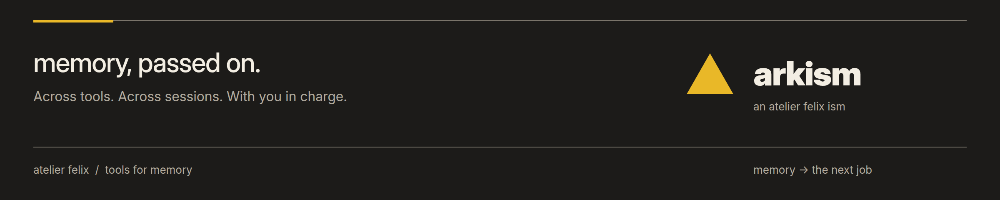

# Arkism

 

**Memory, passed on.** Arkism is an open-source app that lets AI coding agents share memories and skills.

Carry context between Claude Code, Codex and Gemini CLI. Arkism collects what is worth keeping from your conversations and hands over approved memories that match the current job. A test with real agents showed memories reaching the task, but no gain over a static instructions file yet ([report](evaluation/reuse-20261015/REPORT.ko.md), Korean). Manage memory, tools, model selection and team workflows in one place.

> Arkism is still in testing and development. The product overview below and the [future roadmap](ROADMAP.md) describe different stages of the work.

---

## 1. Keep the context as your work moves on

- **Shared memory.** Keep decisions, preferences and solutions with their sources.
- **You decide what stays.** AI-generated notes are candidates. Agents use them after a person approves them.
- **Shared skills.** Manage working methods with versions and history. Any agent connected through MCP can load them; installing them as skill folders covers Claude Code, Codex and ZCode only.
- **Connected work.** Configure tasks and teams through model routing and Arkism's own workflow engine.

Start on your own PC, without an Arkism account or Docker. Memory extraction uses your chosen model and agent login. Your model provider's terms and charges still apply.

---

## 2. How memory carries on

### 2.1 Gather

Turn decisions, preferences and solutions from connected agents' conversations into candidates. Keep a link to the source text, and filter private markers and excluded folders first on supported capture paths.

### 2.2 Check and approve

Even candidates quoting your own words wait for review. Check the source and meaning, then approve, edit or reject the note. AI analysis does not replace your approval.

### 2.3 Find and hand over

Find approved memories that fit the current task, merge their rankings and pass them within a size limit. Searching by meaning needs embeddings; keyword search works without them.

### 2.4 Look back at use

Keep delivery records separate from task outcome signals. Delivering a memory does not establish that the model used it or that it caused a good result.

### 2.5 Tend memory — dreaming

**The full improvement loop is in development.** Build on duplicate and conflict proposals and outcome signals: review the reason and scope of a change, apply what a person approves, then check it in later work. Proposals, approvals, applied changes and confirmed benefits are tracked separately.

The [roadmap](ROADMAP.md) describes the order of improvements and the conditions for accepting them.

---

## 3. From memory to work

| Area | What you can do |
|---|---|
| **MEMORY** | Review candidates; search, edit, merge and delete memories; view and export sessions; check usage. |
| **FLOW** | Manage individual work, collaboration, meetings, and automations together, retaining role/persona settings, graphs, and history. |
| **ROUTER** | Register model providers and accounts, set routing rules and fallback order, and inspect call records. |
| **TOOLS** | Manage skill versions and validation records, see the success or failure results agents report after using a skill (self-reported, not independently checked), connect MCP servers and plugins per agent, and manage knowledge sources. |

Workflows run on Arkism's own Go engine. Team meetings and task execution are managed as separate flows.

---

## 4. Get started

1. Download the latest installer from [Releases](https://github.com/FelixBaek/arkism/releases/latest). Only Windows installers are available for now.
2. Open the app, choose **Use on this PC** (이 PC에서 쓰기) and press **Start**. The server and database run on your PC.
3. The app connects your agents (Claude Code, Codex and others) to Arkism by itself. Their settings files are backed up first, and **Get started** (시작하기) on Home shows where. Restart any agent that was open.
4. Extracting memory candidates needs a signed-in Claude Code, Codex or Gemini CLI. **Get started › Memory extraction model** on Home says whether it is ready.
5. Work as usual, then review candidates on Home or in **MEMORY** and approve only what you want agents to use later.

Current Windows installers do not have Authenticode publisher signing, so SmartScreen may warn. App update verification signatures are separate. See the [security guide](https://github.com/FelixBaek/arkism/blob/main/guide/security-operations.md) for installation and update checks.

To share one Arkism across several PCs, choose **Connect to a server over SSH** (서버에 SSH로 연결) in the app. Arkism must be installed on the server first: see [server mode](https://github.com/FelixBaek/arkism/blob/main/guide/server.md) ([Korean](https://github.com/FelixBaek/arkism/blob/main/guide/server.ko.md)).

---

## 5. Where your data lives and how it is used

**Built-in mode stores data on your PC.** This includes memories, skills, session records and usage. Archived session transcripts are encrypted. Server mode uses the database on the server you configure.

Creating a memory candidate sends relevant parts of a conversation to your chosen model provider. Model routing and connected external tools may also communicate with their respective providers.

- Pause capture or exclude folders. You can also exclude a folder with `.arkism-ignore`.
- Content marked with `<private>…</private>` is excluded before extraction or model transfer on supported capture paths. Sessions containing the marker are also excluded from raw transcript archiving.
- Delete memories and sessions, export sessions, and back up or restore data. Capture exclusions and deletion of previously stored data are separate controls.

See the [capture privacy guide](https://github.com/FelixBaek/arkism/blob/main/guide/capture-privacy.md) for scope and limits, and the [backup guide](https://github.com/FelixBaek/arkism/blob/main/guide/backup-restore.md) for recovery.

---

## 6. Development and checks

| Automated checks | Coverage of the checks |
|---|---|
| **Server and data** | Go tests and concurrency checks, PostgreSQL integration tests, OpenAPI structure and actual response validation, and offline evaluation regression tests. |
| **Windows and desktop** | Windows paths, installation recovery and uninstall boundaries; Rust/Tauri tests; UI and keyboard regression checks in Windows Chromium. |
| **Security and code quality** | CodeQL, gitleaks, govulncheck and SonarCloud analysis. |
| **Test coverage** | Codecov tracks Go, UI and Windows installation code coverage and checks requirements for changed code. |

Routine browser regression checks are separate from production builds and screen comparisons. Production builds and screen comparisons require a manual option; installer generation and release publishing also have separate conditions. See [GitHub Actions](https://github.com/FelixBaek/arkism/actions) for recent runs.

Product improvements begin with reproducible comparisons. Compare new methods with existing ones under the same conditions, recording failures, retries, unknown outcomes and total costs alongside successes. Passing automated checks and demonstrating value in real work require separate evidence.

See the [development guide](https://github.com/FelixBaek/arkism/blob/main/guide/development.md) for the environment and commands, [CONTRIBUTING](https://github.com/FelixBaek/arkism/blob/main/CONTRIBUTING.md) for how to contribute, and [SECURITY](https://github.com/FelixBaek/arkism/blob/main/SECURITY.md) for reporting vulnerabilities.

---

## 7. Where we are heading

**Build a basis for comparison, strengthen memory and recovery, then expand where the evidence supports it.** The plan covers memory quality, understandable correction states, team execution, model selection and tool compatibility.

[Explore the illustrated roadmap →](ROADMAP.md)

---

## License

[MIT](https://github.com/FelixBaek/arkism/blob/main/LICENSE)

### FLOW calls and research

`@리서치` starts normal research; the configured `@딥리서치` alias enters deep research in the same definition. Review and save the existing research upgrade in FLOW to enable source/gap checks while preserving models, search services, approvals, and budgets. Elapsed time alone never escalates research. Existing `$handle` calls remain available.

Connected agents use `run_workflow` and repeat `wait_workflow` on the same run until completion. Closed conversations are not automatically awakened; reconnect and retrieve the same run. Discord persists final-delivery receipts and resumes acknowledged message parts after restarts. Unknown send outcomes are not blindly retried. [Call and support contract](guide/flow.md)
