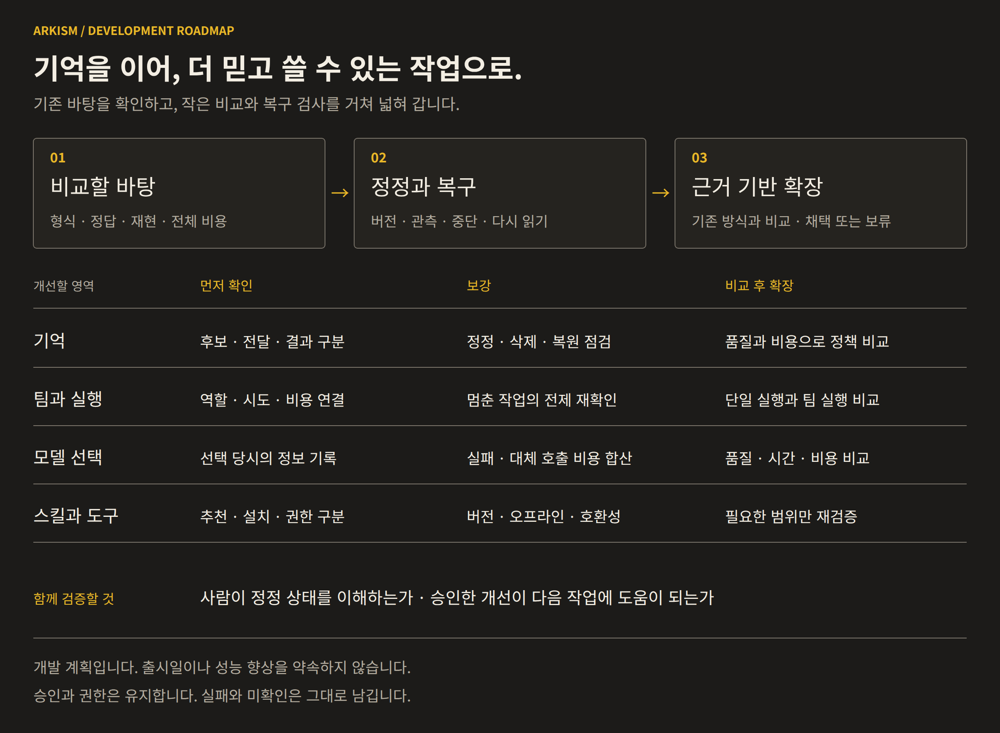
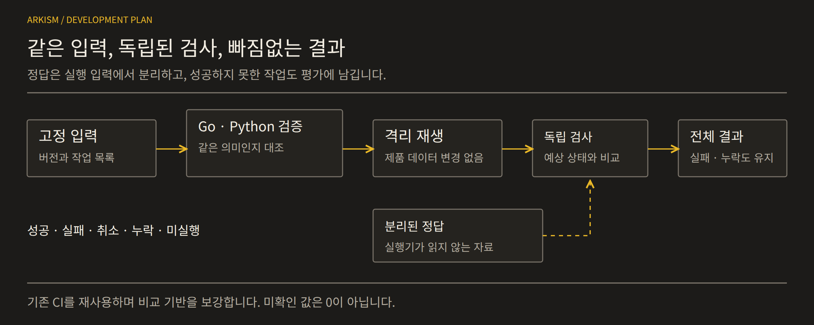
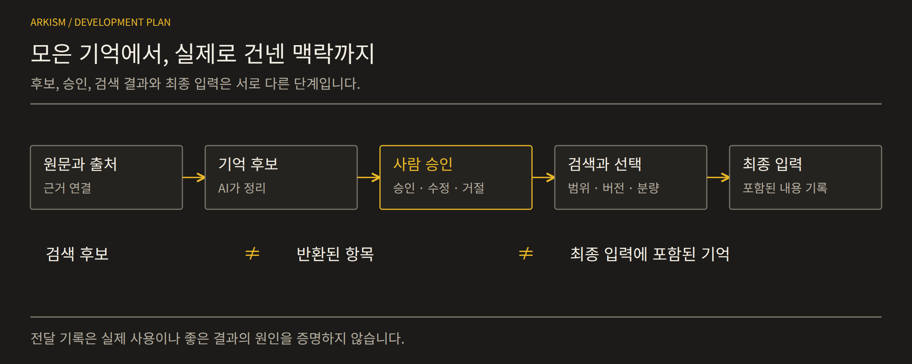
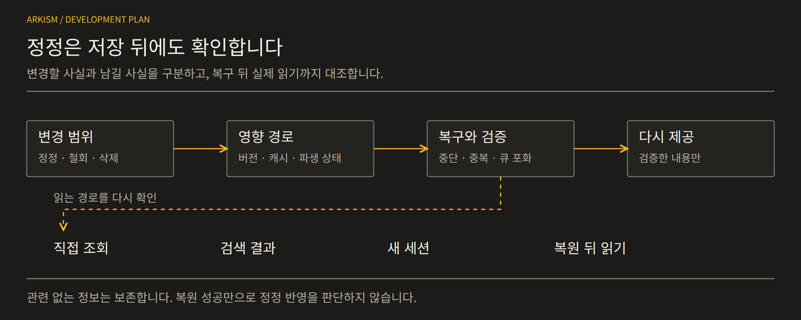
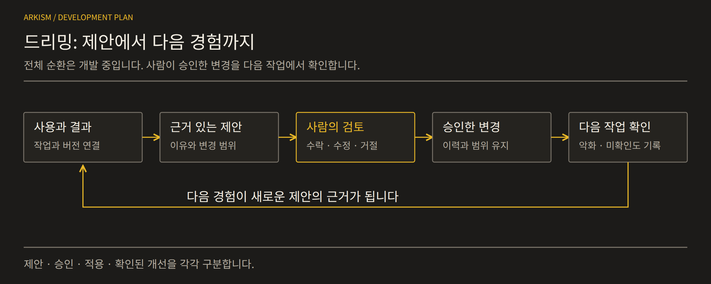
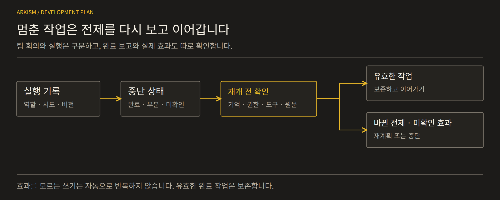
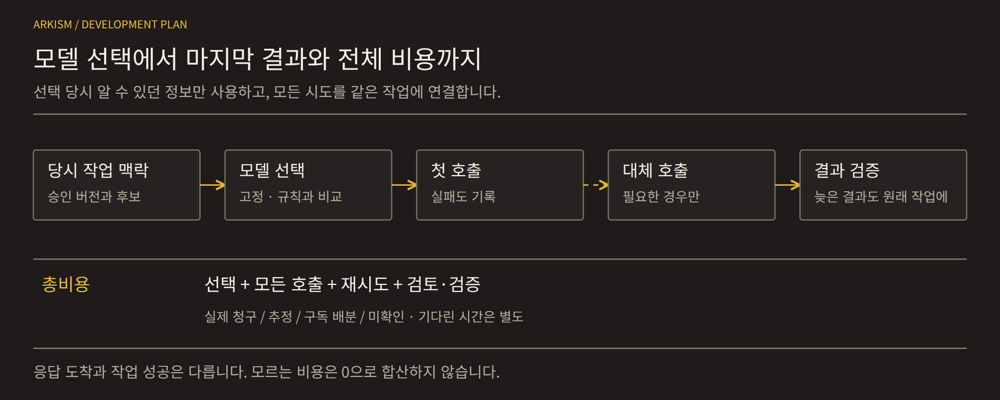
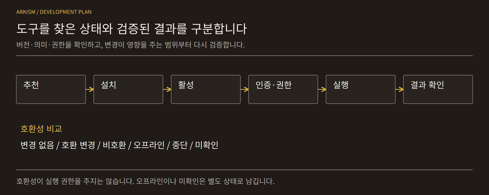

# Arkism 로드맵

 

**기억을 믿고 고치고, 멈춘 일을 이어 가며, 결과와 비용을 설명할 수 있는 작업 기반.**
Arkism은 이미 있는 기억과 실행 기능을 다듬고, 필요와 근거가 확인된 부분부터 넓힙니다.
전체 구성은 [프로젝트 소개](README.ko.md)에서 볼 수 있습니다.

이 문서는 개발·연구 방향을 정리합니다. 단계는 의존 순서이며 출시일의 약속이 아닙니다.
기능의 존재, 구현 검증, 실제 사용 효과는 각각 확인합니다. 계획을 완료된 기능으로 표시하지 않습니다.

---

## 한눈에 보기

| 순서 | 영역 | 확인할 결과 |
|---|---|---|
| 1 | 재현과 평가 | 같은 입력의 재생, 실패를 포함한 전체 결과 |
| 2 | 수집·검토·검색 | 원문에서 최종 입력까지의 근거 |
| 3 | 정정과 복구 | 재시작·복원 뒤에도 유지되는 변경 |
| 4 | 드리밍 | 경험에서 승인한 변경과 후속 결과 |
| 5 | 팀과 재개 | 완료 작업 보존과 중복 실행 방지 |
| 6 | 라우팅과 총비용 | 선택 당시 문맥, 모든 시도의 품질·시간·비용 |
| 7 | 스킬·MCP·플러그인 | 버전·권한·호환성·실제 결과 |
| 8 | 사용자 이해와 행동 | 정확한 상태 판단과 필요한 조치 |
| 9 | 개발 순서와 채택 | 의존 관계, 실제 검증, 되돌릴 방법 |

**현재 검증 기반:** Go·PostgreSQL 통합·Windows·Rust/Tauri·브라우저 회귀 검사,
API 응답 검증, 오프라인 평가 검사와 커버리지 추적이 CI에 있습니다.
제품 빌드·화면 비교·릴리스 검사는 별도 실행 조건이 있고, 일부 빌드는 수동 실행합니다.
일반 CI 통과가 이 모든 검사와 로드맵 항목의 완료를 뜻하지는 않습니다.

---

## 1. 다시 실행하고, 실패까지 남기는 평가

**현재:** 기존 실행 엔진과 CI를 비교 기준으로 삼습니다.
**계획:** 제품 데이터나 외부 모델 호출 없이 결과를 재현하는 평가 경로를 보강합니다.

- 기존 데이터 계약과 표준 표현을 유지하고, 추가 기록은 별도 버전으로 만듭니다. 지원하지 않는 필드와 중복 키는 거절합니다.
- 독립적인 Go·Python 검증기가 같은 바이트를 같은 의미로 읽는지 대조합니다. 작업 목록과 입력을 연결하고, 검사 정답은 실행 입력에서 분리합니다.
- 정상·실패 사례, 시간 감쇠의 단위·경계값, 순위 결합의 동률 처리, 문맥 예산 내 배치를 작은 고정 사례로 확인합니다. 비교 구현과 실제 제품 검색을 구분합니다.
- 파일만 읽는 재생 명령으로 같은 입력의 결과를 다시 만듭니다. 입력 변경과 비정상 종료를 감지하고 제품 DB 쓰기·외부 호출을 막습니다.
- 예정된 전체 작업을 기준으로 성공·실패·취소·누락·미실행을 집계합니다. 미측정값을 0으로 바꾸지 않고 실제 확인 범위를 함께 표시합니다.

**필요한 산출물:** 버전 명세, 입력 목록, 분리된 정답, 고정 기대값, 재생 명령, 결과표와 재현 방법.
**완료 기준:** 두 검증기의 해석과 기존 계약 해시가 일치하고, 잘못된 입력과 빠진 결과를 검출합니다.
모든 예정 작업의 상태와 통과·실패·미실행 검사를 다른 사람이 확인할 수 있어야 합니다.

**미확인:** 평가 기반의 완성만으로 고급 정책의 우수성이나 출시 준비를 판단하지 않습니다.

---

## 2. 원문에서 최종 입력까지 이어지는 기억

**현재:** 기억 수집, 후보 검토, 검색과 사용 기록을 연결하는 기반이 있습니다.
**계획:** 각 단계의 선택과 제외를 추적하고 출처·접근 범위·현재 버전을 유지합니다.

- 사용자가 실제로 말한 원문과 모델이 해석한 후보를 구분합니다. 분류나 위험 판단이 사용자 승인을 대신하지 않습니다.
- 승인·수정·거절 전에 원문, 바뀔 내용, 중복·충돌을 이해할 수 있도록 검토 흐름을 다듬습니다.
- 정확 일치·키워드·벡터 근거와 선택적인 관계 정보를 결합하고, 순위와 문맥 예산 안에서 기억을 고릅니다.
- 검색 후보, 반환된 결과, 최종 입력에 포함된 기억을 각각 기록합니다. 선택한 버전과 접근 범위를 마지막 전달 단계까지 확인합니다.
- 원문 → 후보 → 승인본 → 검색 → 입력 → 이후 결과를 연결합니다. 전달 기록과 실제 사용·기여의 근거를 구분합니다.

**필요한 산출물:** 수집부터 입력까지의 추적 경로, 검토 상태, 후보·반환·포함·결과를 나눈 기록.
**완료 기준:** 어떤 기억이 왜 선택됐는지 설명하고, 미승인 내용을 분류만으로 신뢰된 기억으로 바꾸지 않습니다.
접근 범위와 현재 버전을 지키면서 이후 결과까지 확인할 수 있어야 합니다.

**미확인:** 기억이 전달됐다는 사실만으로 모델이 사용했거나 답변이 좋아졌다고 판단하지 않습니다.

---

## 3. 복구 뒤에도 유지되는 정정

**현재:** 기존 수정·버전 관리 경로를 출발점으로 삼습니다.
**계획:** 최종 조회와 복원 이후까지 의도한 정정이 유지되는지 확인합니다.

- 이번 답변에서 제외하기, 저장된 사실 정정하기, 철회하기, 삭제하기를 구분합니다. 여러 사실 중 무엇을 바꾸고 무엇을 보존할지 정합니다.
- 이전 버전과 대체 관계를 연결한 것만으로 오래된 접근 경로가 닫혔다고 보지 않습니다. 직접 조회·검색·현재 입력·이후 대화·새 세션을 확인합니다.
- 제품 답변을 바꾸지 않는 관찰 경로로 대안을 비교합니다. 복원된 필드와 실제 읽힌 내용을 대조하고 캐시·재시작·백업 복원 사례를 재현합니다.
- 중복·누락 기록, 갱신 중 중단, 부분 적용과 큐 포화를 다룹니다. 같은 사건이 두 번 적용되지 않게 합니다.
- 복구 중 자료 제공을 막았다면 처리 지연과 이용 불가 시간을 남깁니다. 검증한 정정본을 다시 제공하고 무관한 정보는 보존합니다.

**필요한 산출물:** 정정·철회·삭제·복원 규약, 복구 사례, 큐 포화 처리, 정정 정보의 실제 조회 검사.
**완료 기준:** 재시작·복원 뒤에도 관련 조회가 의도한 변경을 반영하며, 영향 없는 사실은 계속 쓸 수 있습니다.
자료의 이용 불가와 미확인 상태를 성공으로 바꾸지 않아야 합니다.

**미확인:** 복원 파일이 로딩됐다는 사실만으로 정정 유지가 검증됐다고 표시하지 않습니다.

---

## 4. 드리밍 — 경험을 다음 개선으로

**현재:** 중복·모순·반복 실패에 따른 관리 제안과 회고의 교훈 후보가 있습니다.
**계획:** 정리 제안을 경험 → 제안 → 승인 → 적용 → 후속 확인의 순환으로 연결합니다.

- 기억을 접한 사실과 실제 활용을 구분하고, 관련 작업·기억 버전·독립적으로 확인한 결과를 연결합니다.
- 변경안에 이유, 근거, 대상 버전, 바뀔 내용을 표시합니다. 사용자가 수락·수정·거절을 결정합니다.
- 승인한 내용만 반영하고 이전 이력, 접근 범위와 삭제 경계를 유지합니다. 한 번의 실패로 무관한 기억·스킬까지 넓게 고치지 않습니다.
- 변경을 다시 쓴 작업의 결과와 같은 문제의 재발 여부를 확인합니다. 그 증거를 변경 이력과 다음 제안에 연결합니다.
- 거절·효과 없음·판단 불가·악화도 남깁니다. 제안한 수, 적용한 수, 도움이 됐다고 확인한 수를 따로 셉니다.

**필요한 산출물:** 경험·결과 연결 기록, 근거 있는 변경안, 검토 이력, 변경 후 재사용과 후속 확인.
**완료 기준:** 변경의 계기부터 승인과 이후 점검까지 추적하고, 자동 제안·승인 적용·확인된 개선을 구분합니다.
전체 개선 순환은 아직 만드는 중입니다.

**미확인:** 무감독 자기 개선이나 지속적인 품질 향상이 입증됐다는 뜻은 아닙니다.

---

## 5. 멈췄다가 이어 가는 팀과 워크플로

**현재:** Go 기반 자체 엔진에 워크플로·템플릿·페르소나·에이전트·팀 표현이 있습니다.
**계획:** 협업 이력을 보강하고 중단 뒤 유효한 작업을 보존하면서 재개합니다.

- 워크플로 실행, 팀 회의, 완료 작업 인계를 나눕니다. 회의 결론은 검토 후보이며 확정 기억이나 외부 실행 권한이 아닙니다.
- 실행 당시 정의, 역할·모델·문맥 버전·예산·반복 상한을 고정해 기록합니다. 계획·워커 시도·재시도·중간 실패·검토·종합을 추적하고 공유 자료의 출처·범위를 지킵니다.
- 중단은 안전한 경계에서 반영될 수 있음을 명시합니다. 미시도·완료·부분 완료·효과 미확인을 나누고, 읽기 재시도와 쓰기·외부 실행을 다르게 다룹니다.
- 재개할 때 기억·권한·워크플로·공유 원문의 변경을 대조합니다. 유효한 완료 작업은 보존하고, 영향받는 부분만 갱신·재계획·중단합니다.
- 워커의 성공 보고와 별도로 실제 최종 상태를 확인해 중복 효과를 막습니다. 완료 노드 재사용·단일 노드 실행 권한도 일반 재개와 구분합니다.
- 안정된 고정 팀과 단독 실행을 먼저 비교합니다. 정상 작업도 끝낼 수 있는지 확인하고, 근거 없는 팀 결과를 개인 기억의 학습 성과로 바꾸지 않습니다.

**필요한 산출물:** 실행 경로 지도, 문맥·복구 규약, 역할·시도 이력, 중단 사례, 효과 상태와 유효 작업 보존 검사.
**완료 기준:** 누가 무엇을 시도했는지 설명하고, 중복 실행 없이 정상 작업을 완료합니다. 모르는 효과는 미확인으로 남깁니다.

**조건부 확장:** 적응형 팀·워크플로 선택은 고정 실행과 복구가 안정된 뒤 비교합니다.

---

## 6. 선택 당시 문맥과 결과 하나에 드는 총비용

**현재:** 모델 라우팅과 대체 호출 경로가 있습니다.
**계획:** 선택 → 시도 → 결과를 연결하고 실패를 포함한 전체 비용을 계산합니다.

- 선택 당시 정책·후보·작업 문맥·기억 버전을 기록합니다. 나중 결과를 과거 선택의 입력으로 섞거나 새 버전의 성과로 옮기지 않습니다.
- 근거 충분·근거 부족·정정 대기·승인된 변경을 나눕니다. 선택기가 실제로 본 상태를 남기며 대기 제안을 승인본으로 취급하지 않습니다.
- 고정 모델·단순 규칙·기존 대체 호출부터 같은 조건에서 비교합니다. 제공자 응답과 작업 성공을 구분하고 비싼 모델이 잘못된 근거를 해결한다고 가정하지 않습니다.
- 실패 호출·재시도·대체 모델·라우팅·중간 생성·계획·통신·검토·종합·검증을 모두 셉니다. 공통 식별자로 중복과 누락을 확인합니다.
- 실제 청구·가격표 추정·구독 배분·가격 미확인 사용량을 나눕니다. 가격·모델 버전, 캐시 효과와 정책 준비·갱신 비용을 남기고 알려진 합계와 집계 범위를 보여 줍니다.
- 대기·선택·생성·검사·복구를 포함한 사용자 대기 시간과 워커 시간 합계를 구분합니다. 완료 여부·총비용·지연을 함께 판단합니다.

**필요한 산출물:** 라우팅 지도, 선택·시도·결과 기록, 당시 문맥, 시도별 비용 장부, 중복·누락 검사와 집계 범위 보고.
**완료 기준:** 왜 선택했고 결과에 무엇이 들었는지 설명합니다. 미확인 비용을 0으로 바꾸거나 싼 실패를 절감으로 보지 않습니다.

**조건부 확장:** 제한된 적응형 선택은 유용성이 확인될 때만 검토합니다. 평균 비용만으로 강제 지출 상한을 약속하지 않습니다.

---

## 7. 현재 조건에서 쓸 수 있는 스킬·MCP·플러그인

**현재:** 스킬 목록·라우팅·승인 버전 고정·번들 검사·캐시·사용 기록·독립 시험 결과가 있습니다.
**계획:** 기능 발견부터 실제 실행 결과까지 연결하고 필요한 부분만 다시 검증합니다.

- 추천됨·설치됨·활성화됨·인증됨·실행 가능함·결과 검증됨을 나눕니다. 기존 로컬 파일과 변경 불가 번들의 차이도 기록합니다.
- 실제 불러온 버전과 권한을 확인합니다. 고정 번들·캐시 해시만으로 이후 철회가 없었다고 판단하지 않습니다.
- 형식이 같아도 의미·단위·효과·권한 조건이 바뀌었는지 확인합니다. 설명·해시 변경이 모두 비호환이라는 가정도 피합니다.
- 변경 없음·호환 변경·비호환·오프라인·중단·미확인 사례를 로컬에서 재현합니다. 후보 노출·로딩·실행 전 확인·실행·재개·독립 결과를 연결합니다.
- 현재 동작과 비교한 뒤 영향받는 도구만 재검증하고 유효한 완료 작업을 보존합니다. 필요한 연결기는 통신 규약의 호환성도 별도로 확인합니다.

**필요한 산출물:** 기능 상태 목록, 버전·호환성 사례, 로딩부터 결과까지의 기록, 필요한 연결기의 호환성 표.
**완료 기준:** 추천·사용 가능·검증 완료를 구분하며 철회와 오래된 상태를 처리합니다. 유효 작업을 불필요하게 잃지 않아야 합니다.
추천이나 스킬 요구사항이 새로운 실행 권한을 부여해서는 안 됩니다.

**조건부 확장:** 선택적 재검증은 실제 호환성 부족이 확인된 곳부터 적용합니다.

---

## 8. 사용자가 실제 상태를 이해하도록

**현재:** 저장·전달·실제 활용을 구분하는 원칙을 설명에 반영합니다.
**계획:** 정정 적용 범위의 설명과 사용자의 상태 판단·행동을 함께 확인합니다.

- 같은 사실과 기능을 일반 문장과 구조화한 설명으로 제시해 비교합니다.
- 저장 완료, 이번 입력 포함, 답변 반영을 확인한 범위를 나눕니다. 관측하지 못한 반영 여부는 미확인으로 둡니다.
- 다음 작업에 정정본이 입력될지 사용자가 판단한 값과 실제 상태를 대조합니다.
- 필요한 확인·승인·추가 정정과 불필요한 반복 개입을 구분합니다.
- 완료 시간·재시도·취소·실패를 함께 보고 자기보고는 필요한 항목만 수집합니다.

**필요한 산출물:** 같은 내용을 담은 설명안, 상태 정답, 판단·행동·시간 기록과 비교 절차.
**완료 기준:** 안심한다는 느낌뿐 아니라 상태를 정확히 이해하고 적절히 행동하는지 확인합니다.
실제 사용자 비교는 상태 정답·측정 방법·필요한 연구 절차를 준비한 뒤 진행합니다.

**미확인:** 사용자 효과가 이미 입증됐다는 뜻은 아닙니다.

---

## 9. 개발 순서와 채택 기준

**현재:** 기존 동작과 담당 범위부터 확인합니다.
**계획:** 독립 작업은 병렬로 진행하고 공통 데이터·엔진 변경은 순서를 맞춥니다.

- 입력 계약 뒤에 사례를, 같은 작업 목록 위에 지표를 만듭니다. 독립 파서와 팀·라우팅·기능 현황 조사는 병렬 진행하되 재생 명령은 사례·검색 기준에 맞춥니다.
- 문맥·복구 설계는 함께 준비하고 공통 엔진 반영은 조율합니다. 결과 기반 기억에는 결과 연결·버전·중복 방지, 적응형 선택에는 당시 입력·전체 비용이 먼저입니다.
- 시간 감쇠·기억 관계·추출과 회상 경계·여러 워커의 정정 이해는 단순 기준의 실제 부족함이 확인될 때만 넓힙니다. 복잡성 자체를 목표로 삼지 않습니다.
- 기능별 활성화 설정·대체 경로·격리 통합 검사·되돌릴 방법을 준비합니다. 정상 완료와 실패·취소·누락·미실행을 함께 확인합니다.
- 변경 이유·관련 작업·실행한 검사와 결과·남은 한계를 기록합니다. 유용하지 않거나 비용·부담이 커진 확장은 보류합니다.

**필요한 산출물:** 의존 관계 지도, 분야별 검증 근거, 보류 목록, 실제 동작 기준의 출시 점검표.
**완료 기준:** 재현 가능한 근거, 승인·데이터 경계, 유용한 정상 동작과 실행 가능한 대체 경로가 있어야 합니다.
미실행 검사와 해결하지 못한 동작은 그대로 표시합니다. 격리 검사 통과와 외부 공개·배포 결정은 구분합니다.

CI는 이 기준을 확인하는 수단입니다. 검사 수나 통과 표시만으로 제품 효과와 전체 로드맵의 완료를 판단하지 않습니다.

공통 순서는 **현재 기준 확정 → 동작 보강 → 확장 여부 평가**입니다.
각 단계는 남은 한계를 드러낸 상태에서 근거에 따라 다음으로 넘어갑니다.
