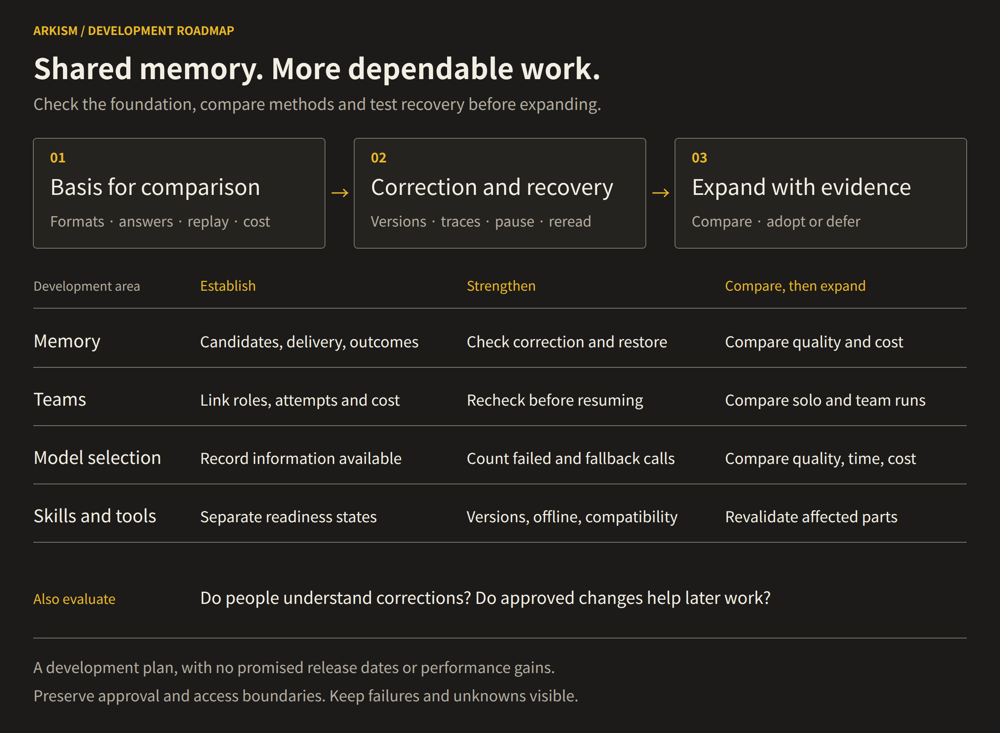
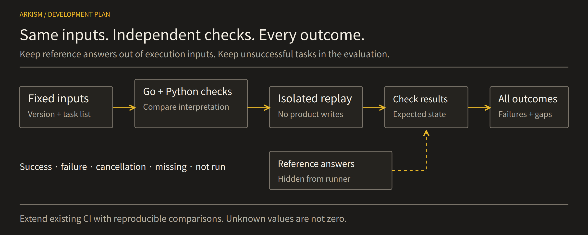
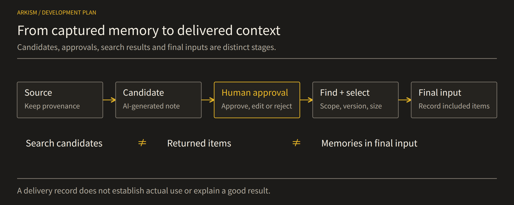
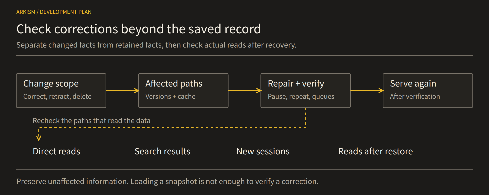
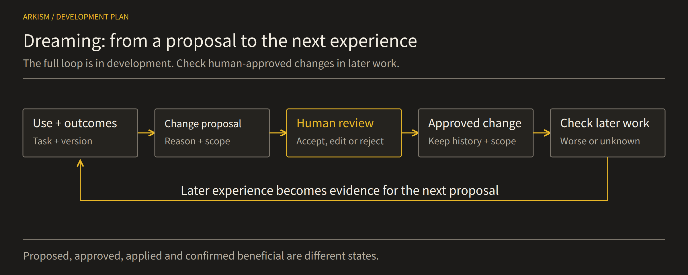
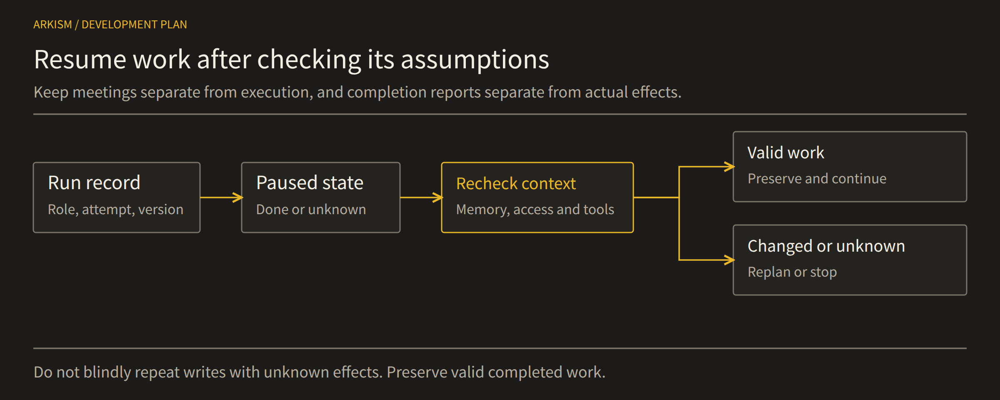
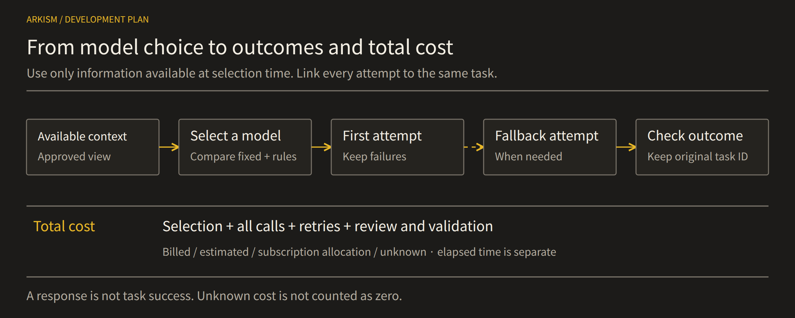
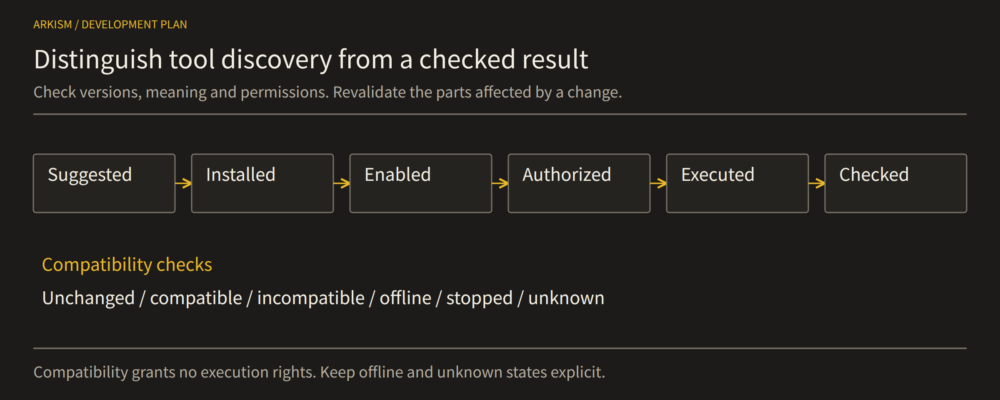

# Arkism Roadmap

 

**A foundation for trusting and correcting memories, resuming interrupted work, and explaining results and costs.**
Arkism refines its existing memory and execution features, extending them where a need and supporting evidence are established.
See the [project overview](README.md) for the full picture.

This document sets out the direction for development and research. Stages express dependencies, not promised release dates.
Feature availability, implementation checks, and benefits in actual use are assessed separately. Planned work is not marked as complete.

---

## At a glance

| Order | Area | What to verify |
|---|---|---|
| 1 | Reproduction and evaluation | Replay of identical inputs and accounting that includes failures |
| 2 | Capture, review, and retrieval | Evidence from the source through to the final input |
| 3 | Corrections and recovery | Changes that survive restarts and restoration |
| 4 | Dreaming | Experience, approved changes, and later results |
| 5 | Teams and resumption | Preservation of completed work without duplicate execution |
| 6 | Routing and total cost | Selection-time context; quality, time, and cost across all attempts |
| 7 | Skills, MCP, and plugins | Versions, permissions, compatibility, and actual results |
| 8 | User understanding and action | Accurate state judgments and necessary actions |
| 9 | Delivery order and adoption | Dependencies, actual verification, and a recovery path |

**Current verification foundation:** CI includes Go, PostgreSQL integration, Windows, Rust/Tauri, and browser regression checks,
API response validation, offline evaluation checks, and coverage tracking.
Product builds, visual comparisons, and release checks have separate execution conditions; some builds run manually.
Ordinary CI passing does not establish that all these checks ran or that the roadmap is complete.

---

## 1. Reproducible evaluation that preserves failures

**Current:** The existing execution engine and CI provide the baseline.
**Planned:** Strengthen an evaluation path that reproduces results without product data or external model calls.

- Preserve the existing data contract and canonical representation; add metadata in separately versioned records. Reject unsupported fields and duplicate keys.
- Compare independent Go and Python validators on the same bytes. Link inputs to the planned workload, and keep checker answers separate from runtime inputs.
- Use small fixed cases for normal and failing behavior, time-decay units and boundaries, ranking ties, and context-budget packing. Distinguish comparison implementations from actual product retrieval.
- Reproduce outputs through a file-only replay command. Detect modified inputs and abnormal exits, without writes to the product database or external calls.
- Account for success, failure, cancellation, missing results, and unexecuted items across the full planned workload. Keep missing values explicit and show actual coverage.

**Required artifacts:** Versioned contracts, input manifests, isolated answers, reference outputs, a replay command, result tables, and reproduction instructions.
**Completion criteria:** Both validators agree, existing contract hashes remain stable, and malformed inputs and missing results are detected.
Another person can inspect the status of every planned item and the checks that passed, failed, or never ran.

**Unverified:** Completing the evaluation foundation does not establish the superiority of advanced policies or readiness for release.

---

## 2. Memory connected from source to final input

**Current:** A foundation connects memory capture, candidate review, retrieval, and usage records.
**Planned:** Trace selection and exclusion at each stage while preserving sources, access scope, and current versions.

- Distinguish what the user actually said from a model's interpretation. Classification or risk assessment does not replace user approval.
- Refine review so the source, proposed changes, duplicates, and conflicts are understandable before approval, editing, or rejection.
- Combine exact-match, keyword, and vector evidence with optional relationship information, then select memories within ranking and context budgets.
- Record retrieval candidates, returned results, and memories packed into the final input separately. Check the selected revision and access scope through final delivery.
- Link source → candidate → approved version → retrieval → input → later outcome. Separate delivery records from evidence of actual use or contribution.

**Required artifacts:** A capture-to-input trace, review states, and distinct records for candidates, returned items, packed context, and outcomes.
**Completion criteria:** Explain why a memory was selected, without turning unapproved material into trusted memory merely through classification.
Preserve access boundaries and current revisions while tracing through to later results.

**Unverified:** Delivery alone does not establish that a model used a memory or that the answer improved.

---

## 3. Corrections that survive recovery

**Current:** Existing editing and versioning paths provide the starting point.
**Planned:** Verify that intended corrections persist through final reads and restored state.

- Distinguish omission from one response, persistent correction, withdrawal, and deletion. Specify which facts change and which remain available.
- A superseding link does not establish that every old access path is closed. Check direct lookups, retrieval, current inputs, later turns, and fresh sessions.
- Compare alternatives through observation paths that do not change product answers. Compare restored fields with actual reads, including caches, restarts, and backup restoration.
- Handle duplicate or missing receipts, interrupted updates, partial application, and full queues. Prevent the same event from being applied twice.
- If affected material is withheld during repair, record repair delays and unavailability. Validate corrected content before releasing it again, preserving unaffected information.

**Required artifacts:** Correction, withdrawal, deletion, and restoration contracts; recovery cases; queue-saturation handling; and actual-read checks.
**Completion criteria:** Relevant reads reflect the intended changes after restart or restoration, while unaffected facts remain usable.
Unavailable and unverified states must not be converted into success.

**Unverified:** Loading a restored file does not by itself verify that corrections survived.

---

## 4. Dreaming — turning experience into the next improvement

**Current:** Maintenance suggestions address duplicates, contradictions, and recurring failures; retrospectives can produce lesson candidates.
**Planned:** Connect those suggestions into experience → proposal → approval → application → follow-up verification.

- Distinguish exposure from actual use, linking the relevant task, memory revision, and independently checked outcome.
- Show each proposal's reason, supporting evidence, target revision, and intended change. The user decides whether to accept, edit, or reject it.
- Apply only approved changes while preserving history, access scope, and deletion boundaries. One failure must not trigger broad changes to unrelated memories or skills.
- Check results and recurrence of the original problem when the change is reused. Connect that evidence to its history and the next proposal.
- Retain rejected, ineffective, inconclusive, and harmful changes. Count proposals, applied changes, and changes confirmed to help separately.

**Required artifacts:** Linked experience and outcome records, evidence-backed proposals, review history, reuse records, and follow-up checks.
**Completion criteria:** Trace the trigger through approval and later checks, distinguishing automatic proposals, approved application, and demonstrated improvement.
The complete improvement cycle is still being built.

**Unverified:** This does not establish unsupervised self-improvement or continuous quality gains.

---

## 5. Teams and workflows that can pause and resume

**Current:** Arkism's own Go engine represents workflows, templates, personas, agents, and teams.
**Planned:** Strengthen collaboration history and preserve valid work when resuming after interruptions.

- Separate workflow runs, team meetings, and completed-work handoffs. Meeting conclusions are review candidates, not trusted memory or permission for external actions.
- Record the run's fixed definition, roles, models, context versions, budgets, and loop limits. Trace planning, worker attempts, retries, intermediate failures, review, and synthesis; retain shared-source boundaries.
- State that stopping may take effect at a safe boundary. Distinguish unattempted, completed, partial, and unknown effects; handle read retries differently from writes and external actions.
- Compare changes to memories, permissions, workflows, and shared sources on resumption. Preserve valid completed work; refresh, replan, or stop only the affected parts.
- Check the actual final state independently of worker success reports to prevent duplicate effects. Keep completed-node reuse and single-node execution permissions separate from ordinary resumption.
- Compare stable fixed teams with solo execution first. Verify that legitimate work still completes, and do not credit team outcomes to personal-memory learning without independent evidence.

**Required artifacts:** Execution-path maps, context and recovery contracts, role and attempt history, interruption cases, effect states, and preservation checks.
**Completion criteria:** Explain who attempted what and complete legitimate work without duplicate effects. Unknown effects remain unknown.

**Conditional extension:** Compare adaptive team and workflow selection only after fixed execution and recovery are reliable.

---

## 6. Context at selection and the full cost of a result

**Current:** Model routing and fallback paths exist.
**Planned:** Connect decisions → attempts → outcomes, accounting for total cost including failures.

- Record the policy, candidates, task context, and memory revision at selection. Do not feed later results into earlier decisions or reassign outcomes to newer revisions.
- Distinguish sufficient evidence, missing evidence, pending corrections, and approved changes. Record what the selector actually saw; a pending proposal is not an approved revision.
- Compare fixed models, simple rules, and existing fallbacks under the same conditions first. Distinguish provider responses from task success; a costly model does not automatically repair invalid evidence.
- Count failed calls, retries, fallbacks, routing, intermediate generation, planning, communication, review, synthesis, and verification. Use shared identifiers to detect duplicates and omissions.
- Separate actual charges, price-based estimates, subscription allocation, and unpriced usage. Retain price and model versions, cache effects, and policy preparation and update costs; show known totals and accounting coverage.
- Separate user waiting time, including queues, selection, generation, checks, and recovery, from summed worker time. Judge completion, total cost, and latency together.

**Required artifacts:** A routing map, linked decision–attempt–outcome records, time-consistent context, an attempt ledger, and duplicate, omission, and coverage reports.
**Completion criteria:** Explain the choice and the resources required for its result. Unknown costs are not zero, and cheap failures are not savings.

**Conditional extension:** Consider bounded adaptation only when useful behavior is demonstrated. Low average cost does not establish a hard spending cap.

---

## 7. Skills, MCP, and plugins usable under current conditions

**Current:** Skill inventories, routing, approved-version pinning, bundle checks, caching, usage traces, and independent trial results exist.
**Planned:** Connect discovery to actual results and revalidate the parts that need it.

- Distinguish recommended, installed, enabled, authenticated, executable, and result-verified states. Record the differences between legacy local files and immutable bundles.
- Check the version actually loaded and its permissions. A pinned bundle or cache hash does not establish that no later revocation occurred.
- Check changes in meaning, units, effects, and permissions even when schemas match. A changed description or hash is not automatically incompatible either.
- Reproduce unchanged, compatible, incompatible, offline, interrupted, and unknown cases locally. Link candidate exposure, loading, preflight, execution, resumption, and independent results.
- Compare current handling before revalidating affected tools, preserving valid completed work. Check protocol compatibility separately for connectors that need it.

**Required artifacts:** A capability-state inventory, version and compatibility cases, loading-to-outcome records, and connector compatibility tables where needed.
**Completion criteria:** Distinguish recommendations, availability, and verified results while handling revocations and stale state without unnecessary loss of valid work.
Recommendations and skill requirements must not grant new execution permissions.

**Conditional extension:** Introduce selective revalidation where an actual compatibility gap is established.

---

## 8. Helping users understand the actual state

**Current:** Explanations reflect the distinction between saving, delivery, and actual use.
**Planned:** Evaluate explanations of correction scope alongside users' state judgments and actions.

- Compare ordinary prose and structured explanations of the same facts and features.
- Show separately what was saved, included in the current input, and confirmed in the response. Keep unobservable use marked as unknown.
- Compare users' predictions about whether the corrected version will enter the next task's input with the actual state.
- Distinguish necessary checks, approvals, and further corrections from unnecessary repeated intervention.
- Examine completion time, retries, cancellations, and failures together; collect self-reports only where needed.

**Required artifacts:** Equivalent explanation variants, state ground truth, judgment and action records, timing records, and comparison procedures.
**Completion criteria:** Check accurate understanding and appropriate action, beyond simply feeling more reassured.
Comparisons with actual users begin after state ground truth, measurement methods, and necessary research procedures are ready.

**Unverified:** User benefits have not already been established by this plan.

---

## 9. Delivery order and adoption criteria

**Current:** Start by identifying existing behavior and ownership.
**Planned:** Run independent work in parallel while coordinating shared data and engine changes.

- Derive fixtures from input contracts and metrics from the same workload. Independent parsers and team, routing, and capability inventories can proceed together; align replay with fixtures and reference retrieval.
- Prepare context and recovery designs together, then coordinate engine integration. Outcome-aware memory needs valid result links, revisions, and duplicate protection; adaptive selection needs time-consistent inputs and complete costs.
- Extend time decay, memory relationships, extraction and recall boundaries, or correction understanding across workers only where simple baselines show a real gap. Complexity is not a goal in itself.
- Prepare feature flags, fallback paths, isolated integration checks, and practical rollback. Check normal completion alongside failure, cancellation, missing results, and unexecuted work.
- Record the reason for each change, work references, checks actually run, their results, and remaining limits. Defer extensions that do not help or add excessive cost or effort.

**Required artifacts:** A dependency map, evidence for each workstream, deferred options, and a release checklist tied to actual behavior.
**Completion criteria:** Require reproducible evidence, approval and data boundaries, useful normal operation, and a practical fallback.
Keep unrun checks and unresolved behavior visible. Passing isolated checks and decisions about external release or deployment remain separate.

CI helps assess these criteria. Check counts and passing statuses alone do not establish product benefits or completion of the entire roadmap.

The shared sequence is **establish the baseline → strengthen behavior → evaluate extensions**.
Each stage advances on evidence, with its remaining limits visible.
